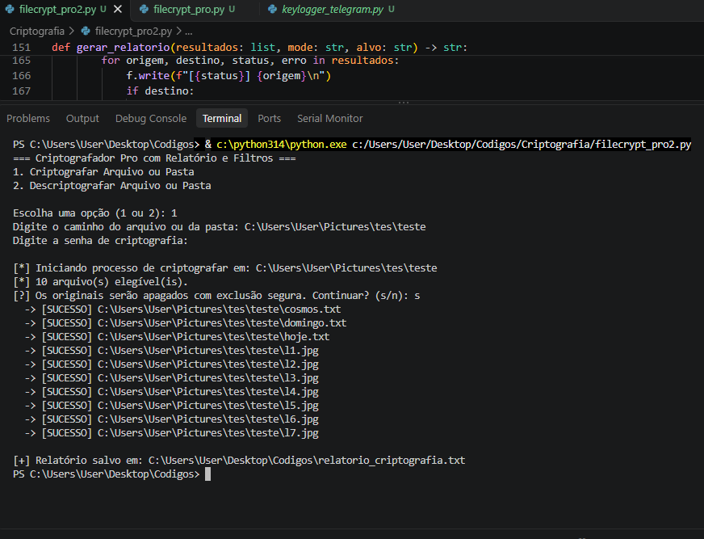
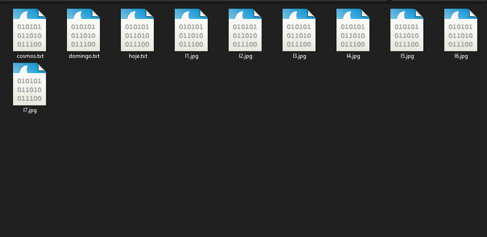
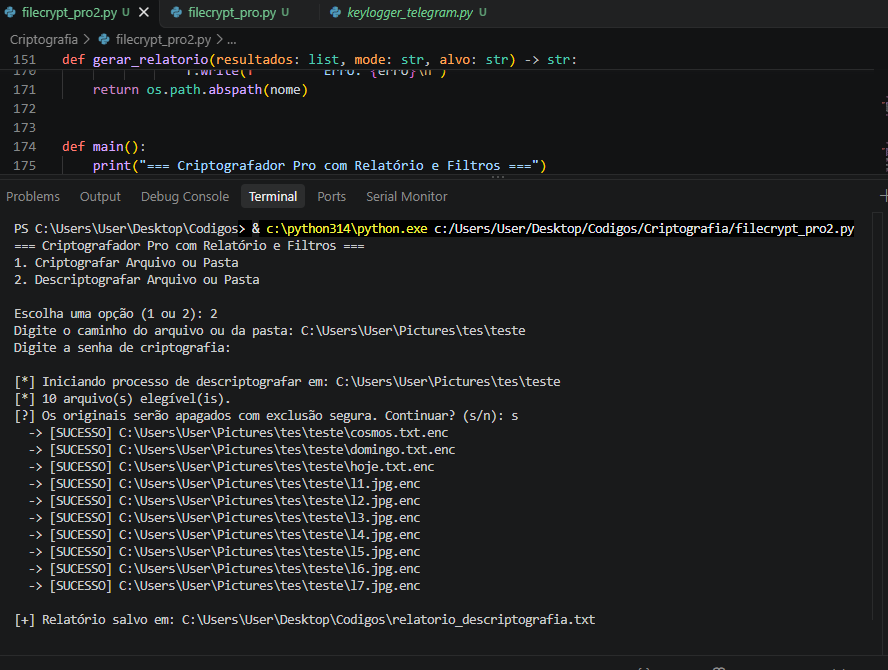
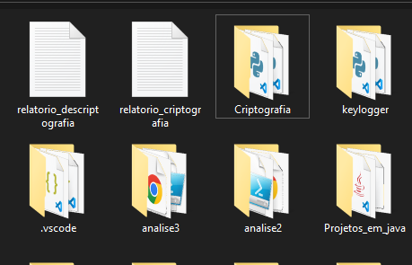
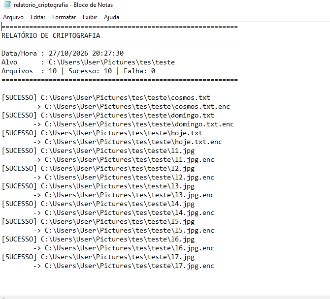
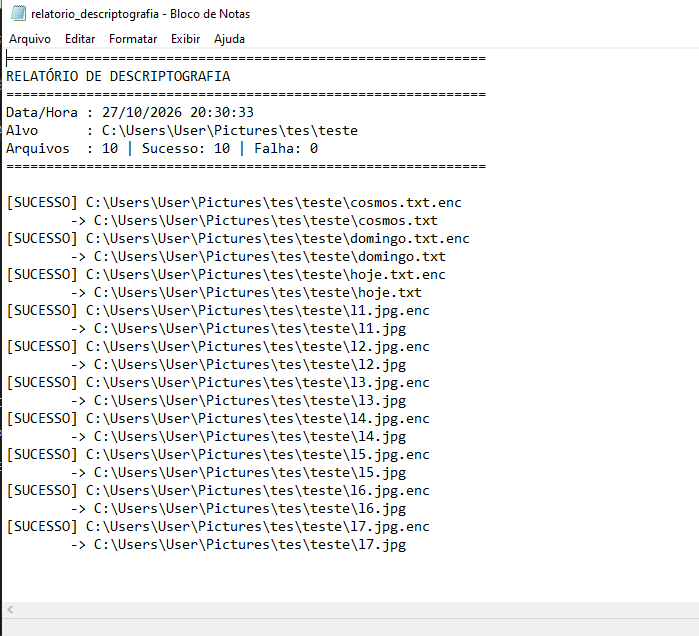

# File Encryption Pro
 
 # 🔐 File Encryption Pro — Criptografador de Arquivos em Python

Ferramenta de criptografia e descriptografia de arquivos e diretórios desenvolvida em Python, utilizando **AES-256-GCM** para proteção dos dados e **PBKDF2-HMAC-SHA256 com 600.000 iterações** para derivação de chaves a partir de uma senha.

O projeto inclui filtros de arquivos, processamento em lote, geração de relatórios e uma rotina de sobrescrita dos arquivos originais antes da remoção.

```bash

#!/usr/bin/env python3
"""
file_encryption_pro.py - Criptografador Pro com Relatório e Filtros
AES-256-GCM + PBKDF2 (600.000 iterações)
Exclusão segura com sobrescrita dos originais antes da remoção.
"""

import os
import sys
import getpass
import traceback
from datetime import datetime

from cryptography.hazmat.primitives.ciphers.aead import AESGCM
from cryptography.hazmat.primitives.kdf.pbkdf2 import PBKDF2HMAC
from cryptography.hazmat.primitives import hashes

MAGIC = b"FCRYPT1"
SALT_SIZE = 16
NONCE_SIZE = 12
KDF_ITERATIONS = 600_000
EXT_ENC = ".enc"

# Extensões ignoradas na criptografia (arquivos de sistema/imagem de disco grandes etc.)
FILTRO_IGNORAR = {".exe", ".dll", ".sys", ".iso", ".tmp"}
TAMANHO_MAX_MB = 2048  # ignora arquivos maiores que 2 GB


def derive_key(password: str, salt: bytes) -> bytes:
    kdf = PBKDF2HMAC(
        algorithm=hashes.SHA256(),
        length=32,
        salt=salt,
        iterations=KDF_ITERATIONS,
    )
    return kdf.derive(password.encode())


def encrypt_bytes(data: bytes, password: str) -> bytes:
    salt = os.urandom(SALT_SIZE)
    nonce = os.urandom(NONCE_SIZE)
    key = derive_key(password, salt)
    return MAGIC + salt + nonce + AESGCM(key).encrypt(nonce, data, None)


def decrypt_bytes(data: bytes, password: str) -> bytes:
    if not data.startswith(MAGIC):
        raise ValueError("Formato inválido")
    off = len(MAGIC)
    salt = data[off:off + SALT_SIZE]
    nonce = data[off + SALT_SIZE:off + SALT_SIZE + NONCE_SIZE]
    ciphertext = data[off + SALT_SIZE + NONCE_SIZE:]
    key = derive_key(password, salt)
    return AESGCM(key).decrypt(nonce, ciphertext, None)


def wipe_file(path: str, passes: int = 3) -> None:
    """
    Exclusão segura: sobrescreve o arquivo com bytes aleatórios
    (e uma passada final de zeros) antes de removê-lo.
    """
    tamanho = os.path.getsize(path)
    if tamanho == 0:
        return
    with open(path, "r+b") as f:
        for _ in range(passes):
            f.seek(0)
            restante = tamanho
            while restante > 0:
                bloco = os.urandom(min(1024 * 1024, restante))
                f.write(bloco)
                restante -= len(bloco)
            f.flush()
            os.fsync(f.fileno())
        # passada final de zeros
        f.seek(0)
        restante = tamanho
        while restante > 0:
            bloco = b"\x00" * min(1024 * 1024, restante)
            f.write(bloco)
            restante -= len(bloco)
        f.flush()
        os.fsync(f.fileno())


def get_files(path: str, mode: str) -> list:
    """Retorna lista de arquivos a processar, aplicando filtros."""
    if os.path.isfile(path):
        return [path]

    arquivos = []
    for raiz, _, nomes in os.walk(path):
        for nome in nomes:
            caminho = os.path.join(raiz, nome)
            ext = os.path.splitext(nome)[1].lower()

            if mode == "encrypt":
                if ext in FILTRO_IGNORAR or ext == EXT_ENC:
                    continue
                if nome.startswith("relatorio_"):
                    continue
                try:
                    if os.path.getsize(caminho) > TAMANHO_MAX_MB * 1024 * 1024:
                        continue
                except OSError:
                    continue
            else:  # decrypt: só arquivos .enc
                if ext != EXT_ENC:
                    continue

            arquivos.append(caminho)
    return arquivos


def processar(arquivos: list, password: str, mode: str) -> list:
    resultados = []
    for caminho in arquivos:
        try:
            with open(caminho, "rb") as f:
                data = f.read()

            if mode == "encrypt":
                novo = caminho + EXT_ENC
                conteudo = encrypt_bytes(data, password)
            else:
                novo = caminho[:-len(EXT_ENC)] if caminho.endswith(EXT_ENC) else caminho + ".dec"
                conteudo = decrypt_bytes(data, password)

            with open(novo, "wb") as f:
                f.write(conteudo)
                f.flush()
                os.fsync(f.fileno())

            # Exclusão segura do original (nas duas direções):
            # sobrescreve com bytes aleatórios antes de remover.
            # Se qualquer etapa anterior falhar (senha errada, arquivo
            # corrompido, erro de escrita), a exceção dispara ANTES daqui
            # e o original é preservado intacto.
            wipe_file(caminho)
            os.remove(caminho)

            resultados.append((caminho, novo, "SUCESSO", ""))
            print(f"  -> [SUCESSO] {caminho}")

        except Exception as e:
            resultados.append((caminho, "", "FALHA", str(e)))
            print(f"  -> [FALHA]   {caminho} ({e})")
    return resultados


def gerar_relatorio(resultados: list, mode: str, alvo: str) -> str:
    acao = "criptografia" if mode == "encrypt" else "descriptografia"
    nome = f"relatorio_{acao}.txt"
    sucesso = sum(1 for r in resultados if r[2] == "SUCESSO")
    falha = len(resultados) - sucesso

    with open(nome, "w", encoding="utf-8") as f:
        f.write("=" * 60 + "\n")
        f.write(f"RELATÓRIO DE {acao.upper()}\n")
        f.write("=" * 60 + "\n")
        f.write(f"Data/Hora : {datetime.now().strftime('%d/%m/%Y %H:%M:%S')}\n")
        f.write(f"Alvo      : {alvo}\n")
        f.write(f"Arquivos  : {len(resultados)} | Sucesso: {sucesso} | Falha: {falha}\n")
        f.write("=" * 60 + "\n\n")
        for origem, destino, status, erro in resultados:
            f.write(f"[{status}] {origem}\n")
            if destino:
                f.write(f"        -> {destino}\n")
            if erro:
                f.write(f"        Erro: {erro}\n")
    return os.path.abspath(nome)


def main():
    print("=== Criptografador Pro com Relatório e Filtros ===")
    print("1. Criptografar Arquivo ou Pasta")
    print("2. Descriptografar Arquivo ou Pasta\n")

    opcao = input("Escolha uma opção (1 ou 2): ").strip()
    if opcao not in ("1", "2"):
        sys.exit("[!] Opção inválida.")
    mode = "encrypt" if opcao == "1" else "decrypt"

    caminho = input("Digite o caminho do arquivo ou da pasta: ").strip().strip('"')
    if not os.path.exists(caminho):
        sys.exit("[!] Caminho não encontrado.")

    pwd = getpass.getpass("Digite a senha de criptografia: ")
    if not pwd:
        sys.exit("[!] A senha não pode ser vazia.")

    arquivos = get_files(caminho, mode)
    if not arquivos:
        sys.exit("[!] Nenhum arquivo elegível encontrado.")

    acao = "criptografar" if mode == "encrypt" else "descriptografar"
    print(f"\n[*] Iniciando processo de {acao} em: {caminho}")
    print(f"[*] {len(arquivos)} arquivo(s) elegível(is).")

    # Confirmação: os originais serão sobrescritos e apagados
    resp = input(f"[?] Os originais serão apagados com exclusão segura. Continuar? (s/n): ").strip().lower()
    if resp not in ("s", "sim"):
        sys.exit("[!] Operação cancelada pelo usuário.")

    resultados = processar(arquivos, pwd, mode)
    relatorio = gerar_relatorio(resultados, mode, caminho)
    print(f"\n[+] Relatório salvo em: {relatorio}")


if __name__ == "__main__":
    try:
        main()
    except KeyboardInterrupt:
        print("\n[!] Operação cancelada pelo usuário.")
    except Exception:
        traceback.print_exc()
    
```


> **Aviso:** este projeto realiza operações destrutivas. Os arquivos originais são sobrescritos e removidos após o processamento bem-sucedido. Utilize somente em arquivos próprios ou em ambientes para os quais você tenha autorização. Faça backups antes de executar.

## 📌 Funcionalidades

- 🔒 **Criptografia AES-256-GCM:** confidencialidade e autenticação dos dados.
- 🔑 **Derivação de chaves com PBKDF2-HMAC-SHA256:** utiliza 600.000 iterações.
- 🔓 **Descriptografia:** restaura o conteúdo dos arquivos utilizando a senha correta.
- 📁 **Processamento de arquivos e diretórios:** permite selecionar um arquivo individual ou uma pasta.
- 🧹 **Filtros de arquivos:** ignora determinadas extensões e arquivos com mais de 2 GB durante a criptografia.
- 📋 **Relatórios automáticos:** registra data, horário, arquivos processados, status e erros.
- 🔐 **Entrada protegida de senha:** utiliza `getpass` para não exibir a senha digitada no terminal.
- 🎲 **Salt e nonce aleatórios:** gera valores novos para cada operação de criptografia.
- 🗑️ **Rotina de sobrescrita:** tenta sobrescrever o conteúdo original antes de removê-lo.
- ⚠️ **Tratamento de erros:** registra falhas individuais sem interromper necessariamente todo o processamento.

## 🛠️ Tecnologias utilizadas

| Tecnologia | Finalidade |
|---|---|
| Python 3 | Linguagem de programação |
| `cryptography` | Biblioteca de criptografia |
| AES-256-GCM | Criptografia autenticada |
| PBKDF2-HMAC-SHA256 | Derivação de chave a partir da senha |
| `os` | Manipulação de arquivos e diretórios |
| `getpass` | Entrada protegida de senha |
| `datetime` | Registro de data e horário |
| `traceback` | Exibição de detalhes de exceções |

## 📂 Estrutura do projeto

```text
FileEncryptionPro/
├── file_encryption_pro.py
├── README.md
├── requirements.txt
├── .gitignore
└── relatorio_*.txt
```

Os relatórios são gerados durante a execução. Recomenda-se não versionar relatórios que contenham caminhos locais, nomes de arquivos ou outras informações privadas.

## ⚙️ Requisitos

- Python 3.9 ou superior, sujeito à compatibilidade da versão instalada com a biblioteca.
- Biblioteca `cryptography`.
- Permissão de leitura, gravação e remoção nos arquivos selecionados.
- Espaço livre em disco suficiente para gerar os arquivos de saída.

## 🚀 Instalação

### 1. Clone o repositório

```bash
git clone https://github.com/wandreson-silva/File-Encryption-Pro.git
```

Entre na pasta do projeto:

```bash
cd FileEncryptionPro
```

### 2. Crie um ambiente virtual

**Windows:**

```powershell
python -m venv .venv
.venv\Scripts\activate
```

**Linux:**

```bash
python3 -m venv .venv
source .venv/bin/activate
```

### 3. Instale a dependência

```bash
python -m pip install cryptography
```

### 4. (Opcional) Crie o arquivo `requirements.txt`

```text
cryptography
```

Para instalar as dependências posteriormente:

```bash
python -m pip install -r requirements.txt
```

Para ambientes de produção, recomenda-se registrar uma versão testada da dependência.

## ▶️ Como utilizar

Execute o programa no terminal.

**Windows:**

```powershell
python file-encryption-pro.py
```

**Linux:**

```bash
python3 file-encryption-pro.py
```

### Menu principal

```text
=== Criptografador Pro com Relatório e Filtros ===
1. Criptografar Arquivo ou Pasta
2. Descriptografar Arquivo ou Pasta

Escolha uma opção (1 ou 2):
```

### 1. Criptografar arquivos

Selecione a opção `1`, informe o caminho de um arquivo ou diretório e digite uma senha forte.

O programa identifica os arquivos elegíveis, solicita confirmação e inicia o processamento.

Exemplo de caminho:

```text
C:\Users\Usuario\Documents\arquivo.pdf
```

No Linux:

```text
/home/usuario/documentos/
```

Os arquivos criptografados recebem a extensão `.enc`.

Exemplo:

```text
documento.pdf
documento.pdf.enc
```

**Atenção:** após o processamento bem-sucedido, o script tenta sobrescrever e remover o arquivo original.



Os arquivos criptografados:



### 2. Descriptografar arquivos

Selecione a opção `2`, informe o caminho do arquivo `.enc` ou de uma pasta que contenha arquivos criptografados e utilize a mesma senha usada na criptografia.

Exemplo:

```text
documento.pdf.enc
```

O resultado esperado é:

```text
documento.pdf
```

O script também tenta sobrescrever e remover o arquivo `.enc` após a descriptografia bem-sucedida.



Descriptografia bem-sucedida:


> A senha não pode ser recuperada pelo programa. Se for perdida, os dados poderão ficar inacessíveis.

## 🔍 Filtros de processamento

Durante a criptografia, o script ignora os arquivos com as seguintes extensões:

```python
FILTRO_IGNORAR = {
    ".exe",
    ".dll",
    ".sys",
    ".iso",
    ".tmp"
}
```

Outras regras:

- Arquivos com extensão `.enc` não são criptografados novamente.
- Arquivos cujo nome começa com `relatorio_` são ignorados.
- Arquivos maiores que 2 GB são ignorados.
- Durante a descriptografia em diretórios, somente arquivos com extensão `.enc` são selecionados.

O limite é configurado pela variável:

```python
TAMANHO_MAX_MB = 2048
```

## 🔐 Detalhes técnicos da criptografia

### AES-256-GCM

O AES-GCM oferece criptografia autenticada. Além de proteger a confidencialidade, permite detectar alterações nos dados criptografados quando a autenticação falha.

### PBKDF2-HMAC-SHA256

A senha é processada por PBKDF2, com salt aleatório de 16 bytes e 600.000 iterações, para derivar uma chave de 256 bits.

### Nonce e salt

A cada criptografia, o programa gera:

- **Salt:** 16 bytes.
- **Nonce:** 12 bytes.
- **Chave derivada:** 32 bytes.
- **Tag de autenticação:** produzida pelo AES-GCM e incluída na saída criptografada.

### Formato do arquivo

O conteúdo criptografado segue esta organização:

```text
[MAGIC][SALT][NONCE][CIPHERTEXT + TAG]
```

O identificador de formato utilizado é:

```python
MAGIC = b"FCRYPT1"
```

Esse identificador ajuda o programa a reconhecer os arquivos produzidos pelo formato esperado.

## 📊 Relatórios de execução

Ao concluir o processamento, o programa gera um relatório de texto.

Os nomes utilizados são:

```text
relatorio_criptografia.txt
relatorio_descriptografia.txt
```



Os relatórios incluem:

- Data e horário da operação.
- Caminho informado pelo usuário.
- Quantidade de arquivos processados.
- Número de sucessos e falhas.
- Caminhos de origem e destino.
- Mensagens de erro, quando disponíveis.

Exemplo:

```text
============================================================
RELATÓRIO DE CRIPTOGRAFIA
============================================================
Data/Hora : 27/10/2026 19:30:00
Alvo      : /home/usuario/documentos
Arquivos  : 3 | Sucesso: 2 | Falha: 1
============================================================

[SUCESSO] documento.pdf
        -> documento.pdf.enc

[FALHA] arquivo.txt
        Erro: ...
```

Os valores acima são apenas ilustrativos.

Relatorio_criptografia.txt



relatorio_descriptografia.txt



## 🛡️ Boas práticas de segurança

- Faça backups independentes antes de utilizar o programa.
- Teste primeiro com arquivos descartáveis.
- Utilize senhas longas, exclusivas e difíceis de adivinhar.
- Não compartilhe a senha junto dos arquivos criptografados.
- Não armazene senhas no código-fonte.
- Evite executar o programa em diretórios do sistema operacional.
- Mantenha a biblioteca `cryptography` atualizada.
- Não publique arquivos reais criptografados, relatórios privados ou dados pessoais no repositório.

### Limitações importantes

**1. Exclusão segura não é garantida.** A sobrescrita não garante a eliminação definitiva dos dados em SSDs, sistemas de arquivos com copy-on-write, armazenamento em nuvem, snapshots ou backups. O script não deve ser considerado uma ferramenta certificada de sanitização de dados.

**2. Falhas durante a sobrescrita podem causar perda de dados.** O arquivo de destino é gravado antes da tentativa de sobrescrever o original. Se a sobrescrita falhar, o processamento pode ser registrado como falha mesmo que o destino já exista.

**3. Não há recuperação automática.** O programa não mantém uma cópia de segurança nem implementa um mecanismo transacional para restaurar originais removidos.

**4. Arquivos existentes podem ser substituídos.** A abertura do destino com o modo `wb` pode truncar um arquivo preexistente com o mesmo nome. Utilize diretórios de teste e verifique os destinos antes da execução.

**5. A entrada de senha é simples.** O programa solicita a mesma senha para todos os arquivos da operação. Ele não implementa gerenciamento de chaves, recuperação de senha ou controle de acesso multiusuário.

## 🧪 Testes recomendados

Antes de utilizar o programa em dados importantes, verifique:

- Se um arquivo de teste é criptografado corretamente.
- Se a descriptografia com a senha correta recupera os bytes originais.
- Se uma senha incorreta provoca falha de autenticação.
- Se arquivos corrompidos são rejeitados.
- Se os filtros de extensão e tamanho funcionam.
- Se o relatório registra corretamente sucessos e falhas.
- Se o comportamento diante de arquivos de destino preexistentes é o esperado.

**Importante:** faça os testes com cópias descartáveis, pois o script remove os arquivos de origem após o processamento bem-sucedido.

## 🗺️ Melhorias futuras

- [ ] Adicionar modo de simulação (*dry run*).
- [ ] Implementar opção para preservar os arquivos originais.
- [ ] Evitar sobrescrever destinos existentes.
- [ ] Adicionar testes automatizados com `pytest`.
- [ ] Implementar processamento em blocos para reduzir o consumo de memória.
- [ ] Criar uma opção de recuperação e validação de backups.
- [ ] Permitir a configuração dos filtros pelo usuário.
- [ ] Implementar logs com níveis de severidade.
- [ ] Adicionar verificação de integridade após a gravação.
- [ ] Criar interface gráfica opcional.

## 🤝 Contribuições

Contribuições são bem-vindas!

1. Faça um fork do projeto.
2. Crie uma branch para sua alteração.
3. Implemente e teste a melhoria.
4. Envie um pull request com a descrição das mudanças.


## 👨‍💻 Autor

**Wandreson Silva**

Projeto desenvolvido para fins educacionais e de estudo em Python, criptografia aplicada e segurança da informação.

---

⭐ Se este projeto for útil para seus estudos, considere deixar uma estrela no repositório.

**Aviso legal:** o autor não se responsabiliza por perda de dados decorrente do uso inadequado da ferramenta. Utilize o programa somente em arquivos e sistemas para os quais você tenha autorização.

